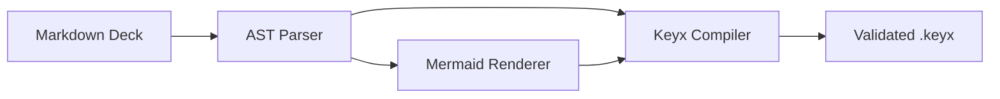

# Markdown to Keynote
## Validated `.keyx` decks straight from plain Markdown

<!-- note: Cover slide generated via md2keyx + apple/creator-studio-doc-format. -->

---
<!-- layout: section -->

# Section 1: Core Features
## Standard CommonMark, Callouts & Syntax Highlighting

---

# Text, Lists & GFM Callouts

This deck compiles **standard Markdown** into schema-validated `.keyx` bundles with *real* Keynote objects, ~~hacks~~, and `inline_code`.

- Top YAML frontmatter sets theme, size, and footer
- HTML comments (`<!-- depth: 2 -->`, `<!-- layout: section -->`) control Keynote cleanly
  - Nested bullet levels map to `ListProperties`
  - Works in GitHub & Obsidian previews without Setext heading bugs
- Links like [Apple .keyx Docs](https://developer.apple.com/documentation/keynoteinterchangeformat) use native `HyperlinkField`

> [!NOTE] Schema Validated
> Every presentation passes `validate_document` before saving, with **zero** `null` override leaks.

> [!TIP]
> Use `> [!TIP]`, `> [!IMPORTANT]`, `> [!WARNING]`, and `> [!CAUTION]` for styled callout cards.

<!-- note: Notice Slide 2 set layout: section, so this slide automatically nested at depth=2 in Keynote's navigator. -->

---

# Syntax-Highlighted Code & Tables

Fenced code blocks lex with Pygments into colored `TextRun`s on dark monospace cards (and `---` inside fences never splits slides):

```python
from pathlib import Path
from markdown2keyx import parse_markdown, compile_deck

# --- Safe inside fenced code! ---
deck = parse_markdown(Path("examples/demo.md").read_text())
compile_deck(deck, Path("out/demo.keyx"), base_dir=Path("examples"))
```

| Feature | `.keyx` Target | Status |
| :--- | :--- | :--- |
| Syntax Highlighting | Pygments -> `TextRun` colors | Supported |
| GFM Callouts | Rounded `Shape` + accent bar | Supported |
| Mermaid Diagrams | 2x PNG `Image` in `Data/` | Supported |

::: notes
Pandoc-style ::: notes blocks also map cleanly to Slide.note.
:::

---
<!-- layout: section -->

# Section 2: Diagrams & Layouts
## Two-Column Slides & Embedded Mermaid Diagrams

---
<!-- depth: 2 -->
<!-- identifier: architecture-overview -->
<!-- columns: 45/55 -->

# Compilation Pipeline

## How Markdown becomes `.keyx`

- **Parse**: YAML frontmatter, slide breaks, callouts, and column splits
- **Render**: High-DPI Mermaid PNGs bundled into `Data/`
- **Compile**: Aspect-preserving `Image` and styled `Shape` geometry

> [!IMPORTANT] CommonMark Compatible
> `<!-- column -->` and `<!-- columns: 45/55 -->` stay invisible in GitHub Markdown previews.

Jump back to [Compilation Pipeline](#architecture-overview).

<!-- column -->



<!-- note: Two-column slide with explicit 45/55 split and embedded Mermaid diagram. -->
